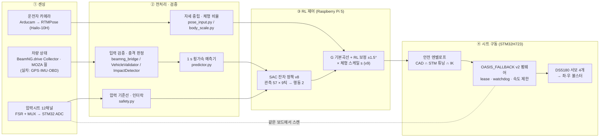

# O.A.S.I.S. — Optimized Active Seat & Intelligent System

> 2026 제24회 임베디드SW경진대회 · 자동차/모빌리티 분야 — 최종 제출 소스코드

주행 중 차량 거동, 시트 압력, 운전자 자세를 실시간으로 받아 **강화학습(RL) 제어기**가 좌·우 **능동 볼스터**의 각도를 정하고,
STM32 펌웨어가 서보를 구동해 코너링 시 운전자의 상체 쏠림을 줄이는 스마트 시트입니다.

---

## 1. 전체 흐름



| 단계 | 하는 일 | 폴더 | 핵심 파일 |
|---|---|---|---|
| **① 센싱** | 실차 주행 데이터 수집 (GPS·IMU·카메라 pose, 압력 12채널) | [`1_Sensor_Acquisition/`](1_Sensor_Acquisition/README.md) | `raspberry_pi/src/oasis_daq/`, `pressure_seat/collect_seat.py` |
| **② 데이터 처리** | 실차 데이터 정제·동기화·자세 보정 → 시뮬레이터 인체/압력 파라미터 근거 | [`2_Data_Processing/`](2_Data_Processing/README.md) | `pipeline/1_vehicle_obd_ocr` ~ `6_driver_seat_equiv` |
| **③ RL 학습** | 시뮬레이터, SAC 학습, 예측기 학습, 체형 스케일 튜닝, 평가 결과 | [`3_RL_Control/sim/`](3_RL_Control/README.md), `results/` | `sim/v3/env_v3.py`, `sim/rl/sac_asym.py`, `sim/v3/tune_body_scale.py` |
| **③ RL 실시간 제어** | Pi 런타임: 입력 수신 → 예측 → RL 추론 → 안전 계층 → 보드 명령 | [`3_RL_Control/deploy/`](3_RL_Control/deploy/README.md) | `runtime/oasis_rt/app.py`, `controller.py`, `g_residual_control.py`, `body_scale.py` |
| **③ PC 연결** | BeamNG → Pi UDP 릴레이, MOZA 휠 송신, 실시간 모니터 | [`3_RL_Control/beamng/`](3_RL_Control/beamng/README.md) | `pi_relay.py`, `moza_sender.py`, `rl_monitor.py` |
| **④ 시트 구동** | STM32 펌웨어(서보 4 + 압력 12ch), 보드 프로토콜, 차량 입력 검증, 백업 제어기 | [`4_Seat_Actuation/`](4_Seat_Actuation/README.md) | `stm32/Core/Src/fallback_control.c`, `experiment_a/transport.py`, `fallback/beamng_bridge.py` |
| 검증 | 하드웨어 없이 전체 제어 경로 SIL 검사 | [`tools/`](tools/verify_seat_control.py) | `verify_seat_control.py` |

---

## 2. 단계별 설명

### ① 센싱 — 주행 중 데이터 수집

- **차량 상태**: 시연은 BeamNG.drive + MOZA R3 휠로 운전하며, Collector v0.3이 횡·종가속도, 속도, 조향각을 25–60 Hz로 내보냅니다.
  `4_Seat_Actuation/fallback/beamng_bridge.py`가 이를 봉투(schema `oasis.beamng.fallback.v1`)로 감싸고 `3_RL_Control/beamng/pi_relay.py`가 UDP로 Pi에 넘깁니다.
- **압력시트**: FSR 12개를 MUX 3개(C0–C3)로 STM32H723 ADC(12 bit, 채널당 약 100 Hz)에서 스캔합니다. 서보 제어와 **같은 보드**입니다.
- **운전자 자세**: Arducam OV9281 → RTMPose. 앞부분(`Mul_204`까지)은 Hailo-10H, 마지막 합성곱과 SimCC head는 CPU에서 계산하는 분할 추론입니다(`oasis_rt/rtmpose_hailo.py`).
- **실차 수집** (`1_Sensor_Acquisition/`): 실차 주행에서 Pi(GPS·IMU·카메라·MediaPipe), 압력 12채널을 UTC 기준으로 동시 기록했습니다.

### ② 처리 — 필터링·동기화·예측

**오프라인 (실차 데이터 → 학습 근거)** — `2_Data_Processing/pipeline/`

| 단계 | 내용 |
|---|---|
| 1_vehicle_obd_ocr | 상용 OBD 앱 화면 녹화를 OCR → 차량 신호 시계열 |
| 2_seat_pressure | 압력 12채널 정제·QC |
| 3_pi_gps_imu_camera | GPS·IMU·카메라 프레임 정제 |
| 4_time_sync | GPS 기준 시계 + IMU 교차상관으로 모든 센서를 10 Hz 단일 시간축에 정렬 |
| 5_pose_correction | RTMPose-x 재추론·보정, 관절별 신뢰 표시 |
| 6_driver_seat_equiv | 조수석 측정값의 운전석 환산 |

여기서 얻은 회전 사건 16개의 압력 응답이 시뮬레이터의 인체·압력 파라미터를 확정했습니다(`3_RL_Control/sim/v3/final/PARAMS_FINAL.md`).

**실시간 (Pi)** — `3_RL_Control/deploy/runtime/oasis_rt/`

- `beamng_rx.py`: 행 나이·간격 ≤ 200 ms, 순번·세션 연속성, 품질 플래그 검사. ARM 후 하나라도 어기면 OFF·종료. 충격 의심(평면 가속 ≥ 25 m/s² 지속 등)이면 즉시 OFF.
- `predictor.py`: 핸들 각·조향 속도 기반 사전 예측 + MLP 잔차로 **0.1–1.0 s 앞 횡가속도**를 예측 (1 s 앞 RMS 0.090 g, hold 대비 64 %).
- `safety.py`, `controller.py`: 압력 기준선(2 s), 패드 압력 인터락, 압력이 없거나 오래되면 yaw 8° 상한.
- `pose_input.py`, `body_scale.py`: 카메라 중립 보정, 어깨폭 비율로 체형 스케일 계산. 카메라가 없거나 끊기면 자세 입력만 unavailable로 처리하고 차량·압력 경로는 계속 동작합니다.

### ③ RL — 제어 결정

- **관측** `oasis-obs-v3.0`: 57개 × (현재 + 과거 8틱) = 513 → MLP 256-256 → 행동 2개 `[공통, 좌우 차등]`.
  예측 횡가속 10개, 차량 상태, 압력 12채널 파생값, 보고 각도, 직전 행동, 체형·휴지 압력이 들어갑니다.
- **정책**: SAC 잔차 정책 `v8_s1`. 튜닝 규칙(`밀릴 쪽 = min(10°, 160°/g × |a_y(0.7 s)|)`) 위에서 ±0.25만 조정하도록 학습했고, 보상은 평가 점수 그 자체입니다.
  추론은 C(`actor_core.c`) 또는 NumPy 백엔드.
- **최종 제어 법칙** (`g_residual_control.py`): 측정 |G| 기본 곡선 `0.01 g→0°, 0.0625 g→10°, 1 g→20°` + **RL 보정 ±1.5°**(1 g에서 0°로 축소). 예측만 있을 때는 100 ms 확인 후 최대 10°.
- **체형 스케일 v9** (`body_scale.py`): `s = clip(1 − 1.2 (어깨폭 비 − 1), 0.9, 1.1)`을 기본각에 곱합니다. 기준 사용자(s = 1) 대비 넓은 체형은 덜 조이고 좁은 체형은 더 조입니다.
- **Fallback**: 액터 예외/NaN → 튜닝 규칙(세션 끝까지), 모델 패키지 없음 → FB V6 제어기(`4_Seat_Actuation/experiment_a/controller.py`).

### ④ 시트 구동 — 안전 계층과 펌웨어

| # | 계층 | 위치 |
|---|---|---|
| 1 | 출력 저역통과 τ 0.3 s | `oasis_rt/actor.py` |
| 2 | 압력 인터락 (60 N 초과 더 조이지 않음, 120 N 초과 해당 측 0°) | `oasis_rt/safety.py` |
| 3 | 엔벨로프 투영: CAD 결합 한계 ∩ STM 튜닝 상한 ∩ C4_R8 역기구학(500–2500 µs) | `oasis_rt/envelope.py` |
| 4 | lease: 건강한 tick 뒤에만 PING, Pi가 멈추면 500 ms 뒤 펌웨어가 PWM OFF | `oasis_rt/fb_link.py` |
| 5 | 보드 링크: 요청 1개 대기, ACK 200 ms, 오류·재부팅 감지 시 latch → 비상 OFF | `4_Seat_Actuation/experiment_a/transport.py` |
| 6 | 펌웨어: CAD/튜닝 밖 목표 거부, 축 속도 제한, 서보당 2 µs/20 ms, 독립 watchdog 2 s | `4_Seat_Actuation/stm32/Core/Src/fallback_control.c` |

서보는 DS5180 270° 4개(좌·우 × 상·하 링크)이며, 패드 yaw/pitch 목표를 C4_R8 역기구학으로 PWM으로 바꿉니다.

---

## 3. 결과

**시뮬레이션 평가** (평가 은행 48 에피소드, 같은 에피소드·같은 구동기 모델, `3_RL_Control/results/v8/eval_unified.json`)

| 제어기 | 점수 J | CoM 감소 (L0 / L2) |
|---|---|---|
| **RL v8 (배포)** | **3.92** | 8.1 / 10.1 % |
| 튜닝 규칙 | 3.93 | 9.8 / 10.8 % |
| FB V6 (백업 제어기) | 1.70 | 3.5 / 4.4 % |
| 볼스터 열림 (passive) | 0 | 0 |

RL은 튜닝 규칙과 같은 수준(48개 중 32개 에피소드에서 우세, 중앙값 차 +0.02)이고, 백업 제어기보다 분명히 낫습니다.
체형 스케일 v9는 넓은 체형에서 지지 +0.3–0.45 %p, 20 N 초과 압박 시간 −0.6–1.25 %p입니다(`results/v9/`).

**실물 착석 시험** (2026-10-28, BeamNG + Pi + STM32 + 실제 착석자)

- 제어 구간 271 s, RL 계산 5,421회, 보드 명령 2,766회, 압력 스캔 27,777회.
- 횡G −1.21 ~ +1.26 g 구간에서 |G| ≥ 1인 78회 모두 요청각 20°, 보드 명령 최대 좌 18.9° · 우 19.9°.
- 모든 세션 종료 시 PWM OFF 확인. 각도는 보드 명령 상태이며 축 센서의 실측값은 아닙니다.

자세한 사양과 한계는 [`3_RL_Control/deploy/CONTROL_SPEC.md`](3_RL_Control/deploy/CONTROL_SPEC.md),
모델 카드는 [`3_RL_Control/sim/v3/MODEL_CARD_v8.md`](3_RL_Control/sim/v3/MODEL_CARD_v8.md)에 있습니다.

---

## 4. 실행과 검증

```sh
# 의존성 (Python 3.11+)
pip install -r 3_RL_Control/deploy/runtime/requirements.txt

# 하드웨어 없이 전체 제어 경로 검증 (모의 보드 + 합성 Collector 행)
python tools/verify_seat_control.py
python tools/verify_seat_control.py --model-dir <model_v8>   # 학습된 모델 패키지가 있을 때

# Pi 런타임 단위 시험
cd 3_RL_Control/deploy/runtime && python -m unittest discover -s tests
```

| 실행 대상 | 문서 |
|---|---|
| Pi 설치·운용, 세션 순서 | [`3_RL_Control/deploy/README.md`](3_RL_Control/deploy/README.md) |
| 10/28 착석 시험 재현 래퍼 | [`3_RL_Control/deploy/experiments/seated_20261028/README.md`](3_RL_Control/deploy/experiments/seated_20261028/README.md) |
| PC ↔ Pi 연결 | [`3_RL_Control/beamng/README.md`](3_RL_Control/beamng/README.md) |
| STM32 빌드·업로드 | [`4_Seat_Actuation/stm32/README.md`](4_Seat_Actuation/stm32/README.md) |
| RL 전체 재현 학습 | `3_RL_Control/sim/v3/final/run_final.sh` |

**저장소에 포함하지 않는 것**: 학습된 모델 가중치(`model_v8`), 원시·정제 주행 데이터와 영상, BeamNG Collector v0.3, STM32CubeH7 SDK, 빌드 산출물.

## 5. 하드웨어

| 구성 | 부품 |
|---|---|
| 상위 제어 | Raspberry Pi 5 + Hailo-10H AI HAT+ |
| 하위 제어 | STM32 NUCLEO-H723ZG |
| 구동 | DS5180 270° 서보 4개, 볼스터 링크 기구 (rack and pinion / universal joint) |
| 센서 | FSR 압력센서 12개 + 아날로그 MUX 3개, Arducam OV9281, GPS, IMU(WIT) |
| 주행 입력 | BeamNG.drive + MOZA R3 휠 (시연), 실차 (데이터 수집) |

## 6. 폴더 구조

```text
2026ESWContest_mobility_O.A.S.I.S/
├─ 1_Sensor_Acquisition/      ① 실차 주행 수집기
│  ├─ raspberry_pi/           GPS·IMU·카메라·MediaPipe pose DAQ (oasis_daq 패키지)
│  ├─ pressure_seat/          압력 12채널 주행 기록기
│  └─ align_sessions.py       장치 간 UTC 정렬
├─ 2_Data_Processing/         ② 실차 데이터 정제 파이프라인
│  └─ pipeline/               1~6단계: OBD OCR → 압력 → Pi 센서 → 시간 동기화 → 자세 보정 → 운전석 환산
├─ 3_RL_Control/              ③ RL 제어기
│  ├─ sim/                    시뮬레이터(인체·시나리오·센서·펌웨어 모델), SAC 학습, 평가
│  ├─ results/                최종 정책(v8)·체형 스케일(v9) 평가 결과
│  ├─ deploy/runtime/         Pi 실시간 런타임 oasis_rt
│  ├─ deploy/export, tools/   모델 패키징, 압력 패드 보정
│  ├─ deploy/experiments/     2026-10-28 착석 시험 래퍼, RTMPose Hailo 분할 레시피
│  └─ beamng/                 PC → Pi 릴레이, MOZA 송신기, 모니터
├─ 4_Seat_Actuation/          ④ 시트 구동
│  ├─ stm32/                  STM32H723 펌웨어 (서보 4 + 압력 12ch)
│  ├─ experiment_a/           보드 프로토콜, 차량 검증, CAD 한계, 기구학, 백업 제어기
│  ├─ fallback/               BeamNG 브리지, 위치 기반 백업 제어
│  └─ gui/                    수동 제어·자동 스윕 측정 스테이션
└─ tools/verify_seat_control.py
```

Python 패키지 이름(`oasis_rt`, `experiment_a`, `fallback`)은 import 경로라서 개발 당시 이름을 그대로 유지했습니다.
