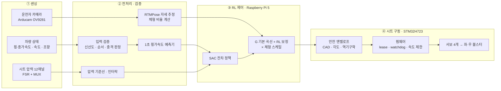

<div align="center">

# O.A.S.I.S.
### Optimized Active Seat & Intelligent System

**주행 상황과 운전자 자세를 읽고, 강화학습으로 시트 볼스터를 능동 제어하는 스마트 시트**

2026 제24회 임베디드SW경진대회 · 자동차/모빌리티 분야

`Raspberry Pi 5` · `Hailo-10H` · `STM32H723` · `Reinforcement Learning (SAC)` · `RTMPose` · `BeamNG.drive`

</div>

---

## 목차
1. [프로젝트 소개](#1-프로젝트-소개)
2. [시스템 전체 흐름](#2-시스템-전체-흐름)
3. [저장소 둘러보기](#3-저장소-둘러보기)
4. [핵심 기술](#4-핵심-기술)
5. [결과](#5-결과)
6. [하드웨어 구성](#6-하드웨어-구성)
7. [실행과 검증](#7-실행과-검증)

---

## 1. 프로젝트 소개

### 문제
코너를 돌 때 운전자의 상체는 원심력 방향으로 밀립니다. 일반 시트의 측면 지지대(볼스터)는 고정되어 있어
몸이 밀리는 정도나 체형과 관계없이 항상 같은 형태로만 받쳐 줍니다.

### 해결
O.A.S.I.S.는 좌·우 볼스터를 서보로 움직이는 **능동형 시트**입니다.

| 단계 | 하는 일 |
|---|---|
| **보고** | 차량의 횡가속도·속도·조향, 시트 압력 12채널, 카메라로 본 운전자 자세를 실시간으로 받습니다 |
| **예측하고** | 앞으로 1초 동안의 횡가속도를 예측해, 몸이 밀리기 **전에** 움직일 수 있게 합니다 |
| **판단하고** | 강화학습(SAC) 정책이 기본 제어 곡선을 보정하고, 운전자 체형에 맞춰 세기를 조절합니다 |
| **움직입니다** | 여러 겹의 안전 계층을 거친 목표 각도를 STM32가 받아 서보 4개로 볼스터를 구동합니다 |

---

## 2. 시스템 전체 흐름



| 단계 | 입력 → 출력 | 주요 코드 |
|:---:|---|---|
| **① 센싱** | 차량·압력·카메라 원시 신호 → 시각이 찍힌 기록 | [`1_Sensor_Acquisition/`](1_Sensor_Acquisition/README.md) |
| **② 처리** | 원시 기록 → 검증·정제·동기화된 데이터 (실시간 / 오프라인) | [`2_Data_Processing/`](2_Data_Processing/README.md), `3_RL_Control/deploy/runtime/` |
| **③ RL 제어** | 관측 57개 × 9틱 → 좌·우 볼스터 목표 각도 | [`3_RL_Control/`](3_RL_Control/README.md) |
| **④ 시트 구동** | 목표 각도 → 안전 검사 → 서보 PWM | [`4_Seat_Actuation/`](4_Seat_Actuation/README.md) |

---

## 3. 저장소 둘러보기

```text
2026ESWContest_mobility_O.A.S.I.S/
├── 1_Sensor_Acquisition/     ① 실차 주행 데이터 수집기 (Raspberry Pi DAQ, 압력 기록기)
├── 2_Data_Processing/        ② 실차 데이터 정제 파이프라인 (OCR → 압력 → 센서 → 동기화 → 자세 보정 → 운전석 환산)
├── 3_RL_Control/             ③ 강화학습 제어기
│   ├── sim/                     학습용 시뮬레이터, SAC 학습, 평가
│   ├── results/                 최종 정책(v8)·체형 스케일(v9) 평가 결과
│   ├── deploy/                  Raspberry Pi 실시간 런타임, 모델 패키징, 실물 시험 래퍼
│   └── beamng/                  PC → Pi 연결, 조향 휠 송신기, 실시간 모니터
├── 4_Seat_Actuation/         ④ 시트 구동
│   ├── stm32/                   STM32H723 펌웨어 (서보 4개 + 압력 12채널)
│   ├── experiment_a/            보드 통신, 차량 입력 검증, CAD 한계, 기구학, 백업 제어기
│   ├── fallback/                주행 시뮬레이터 브리지, 규칙 기반 제어
│   └── gui/                     수동 제어·자동 측정 스테이션
└── tools/
    └── verify_seat_control.py   하드웨어 없이 전체 제어 경로를 검증하는 스크립트
```

### 처음 보신다면 이 순서를 추천합니다

| 순서 | 문서 | 알 수 있는 것 |
|:---:|---|---|
| 1 | 이 README | 프로젝트 전체 그림 |
| 2 | [`3_RL_Control/README.md`](3_RL_Control/README.md) | 제어기의 핵심 아이디어와 성능 |
| 3 | [`3_RL_Control/deploy/CONTROL_SPEC.md`](3_RL_Control/deploy/CONTROL_SPEC.md) | 관측·행동·예측기·안전 계층의 상세 사양 |
| 4 | [`4_Seat_Actuation/README.md`](4_Seat_Actuation/README.md) | 하드웨어 배선, 펌웨어, 안전 장치 |
| 5 | [`1_Sensor_Acquisition/`](1_Sensor_Acquisition/README.md), [`2_Data_Processing/`](2_Data_Processing/README.md) | 실차 데이터를 어떻게 모으고 다듬었는지 |

---

## 4. 핵심 기술

### ① 1초 앞을 보는 횡가속도 예측
조향각과 조향 속도로 만든 물리 기반 예측에 작은 신경망(MLP) 잔차를 더해 **0.1 ~ 1.0초 뒤의 횡가속도**를 예측합니다.
1초 앞 오차는 0.090 g로, 현재 값을 그대로 쓰는 경우(0.140 g)보다 36 % 작습니다. 서보가 느리기 때문에 미리 움직이는 것이 중요합니다.

### ② 강화학습 잔차 정책 (SAC)
처음부터 학습하지 않고, 잘 튜닝된 규칙 제어기 위에서 **작은 보정만 학습**합니다(±0.25).
보상은 평가 점수(상체 흔들림 감소 − 과도한 압박)와 같게 맞춰, 학습 목표와 실제 목표가 어긋나지 않게 했습니다.

### ③ G 기본 곡선 + RL 보정
실물에서는 측정 횡가속도 기반 기본 곡선(`0.0625 g → 10°`, `1 g → 20°`)에 RL 보정을 **±1.5° 이내**로만 더합니다.
예측만 있을 때는 최대 10°로 제한해, 학습 모델이 예상 밖으로 동작해도 위험하지 않게 했습니다.

### ④ 카메라 기반 체형 스케일
카메라로 잰 어깨 폭이 기준 사용자보다 넓으면 덜 조이고, 좁으면 더 조입니다(0.9 ~ 1.1배).
RTMPose는 Hailo-10H NPU와 CPU에 나눠 실행합니다(앞부분 NPU, 마지막 합성곱·출력부 CPU).

### ⑤ 다중 안전 계층
| 계층 | 내용 |
|---|---|
| 입력 검증 | 200 ms보다 오래되거나 순서가 어긋난 데이터, 충격 의심 → 즉시 정지 |
| 압력 인터락 | 압력이 과도하면 더 조이지 않거나 해당 쪽을 엽니다 |
| 안전 엔벨로프 | CAD 간섭 한계 ∩ 펌웨어 각도 상한 ∩ 역기구학 도달 범위 안으로 목표를 제한 |
| lease | Pi가 멈추면 500 ms 뒤 펌웨어가 스스로 PWM을 끕니다 |
| 펌웨어 | 서보당 20 ms에 2 µs까지만 변화, 독립 watchdog 2초 |
| Fallback | RL 실패 → 튜닝 규칙, 모델 없음 → 백업 제어기로 자동 전환 |

---

## 5. 결과

### 시뮬레이션 평가
같은 48개 주행 에피소드, 같은 구동기 모델에서 비교했습니다 (`3_RL_Control/results/v8/eval_unified.json`).

| 제어기 | 종합 점수 J ↑ | 상체 흔들림 감소 |
|---|:---:|:---:|
| **RL 정책 (최종 배포)** | **3.92** | 8.1 ~ 10.1 % |
| 튜닝 규칙 | 3.93 | 9.8 ~ 10.8 % |
| 백업 제어기 | 1.70 | 3.5 ~ 4.4 % |
| 볼스터 고정 (비교 기준) | 0 | 0 % |

- RL 정책은 튜닝 규칙과 같은 수준이며(48개 중 32개 에피소드에서 우세), 백업 제어기보다 분명히 낫습니다.
- 체형 스케일은 넓은 체형에서 지지 효과 +0.3 ~ 0.45 %p, 과도한 압박 시간 −0.6 ~ 1.25 %p를 보였습니다.

### 실물 착석 시험
주행 시뮬레이터(BeamNG.drive + 조향 휠) + Raspberry Pi + STM32 + 실제 착석자로 전체 시스템을 구동했습니다.

| 항목 | 값 |
|---|---|
| 제어 구간 | 271초 |
| RL 계산 / 보드 명령 | 5,421회 / 2,766회 |
| 압력 스캔 | 27,777회 (12채널) |
| 횡가속도 범위 | −1.21 g ~ +1.26 g |
| 최대 명령 각도 | 좌 18.9° · 우 19.9° (목표 20°) |
| 종료 | 모든 세션에서 PWM OFF 확인 |

> 각도는 보드가 받은 명령 값이며, 축 위치 센서로 잰 실측값은 아닙니다.

---

## 6. 하드웨어 구성

| 구분 | 부품 |
|---|---|
| 상위 제어 | Raspberry Pi 5 + Hailo-10H AI HAT+ |
| 하위 제어 | STM32 NUCLEO-H723ZG |
| 구동 | DS5180 270° 서보 4개 (좌·우 × 상·하 링크), 유니버설 조인트 링크 기구 |
| 센서 | FSR 압력센서 12개 + 아날로그 MUX 3개, Arducam OV9281, GPS, IMU |
| 주행 입력 | BeamNG.drive + MOZA R3 휠 (시연), 실차 (데이터 수집) |

---

## 7. 실행과 검증

하드웨어 없이 전체 제어 경로(차량 입력 → RL/규칙 → 안전 계층 → 모의 STM32 보드)를 검증할 수 있습니다.

```bash
pip install -r 3_RL_Control/deploy/runtime/requirements.txt   # numpy, pyyaml, pyserial (Python 3.11+)

python tools/verify_seat_control.py                           # 모델 없이: 백업 제어 경로 검증
python tools/verify_seat_control.py --model-dir <model_v8>    # 학습 모델이 있을 때: RL 경로까지 검증

cd 3_RL_Control/deploy/runtime && python -m unittest discover -s tests   # Pi 런타임 단위 시험
```

| 하고 싶은 것 | 문서 |
|---|---|
| Raspberry Pi에 설치하고 세션 실행 | [`3_RL_Control/deploy/README.md`](3_RL_Control/deploy/README.md) |
| PC(주행 시뮬레이터)와 Pi 연결 | [`3_RL_Control/beamng/README.md`](3_RL_Control/beamng/README.md) |
| STM32 펌웨어 빌드·업로드 | [`4_Seat_Actuation/stm32/README.md`](4_Seat_Actuation/stm32/README.md) |
| RL 모델 처음부터 다시 학습 | [`3_RL_Control/README.md`](3_RL_Control/README.md#재현) |

> **저장소에 포함하지 않은 것:** 학습된 모델 가중치, 원시·정제 주행 데이터와 영상, BeamNG Collector, STM32CubeH7 SDK, 빌드 산출물.
> Python 패키지 이름(`oasis_rt`, `experiment_a`, `fallback`)은 import 경로이므로 개발 당시 이름을 유지했습니다.
